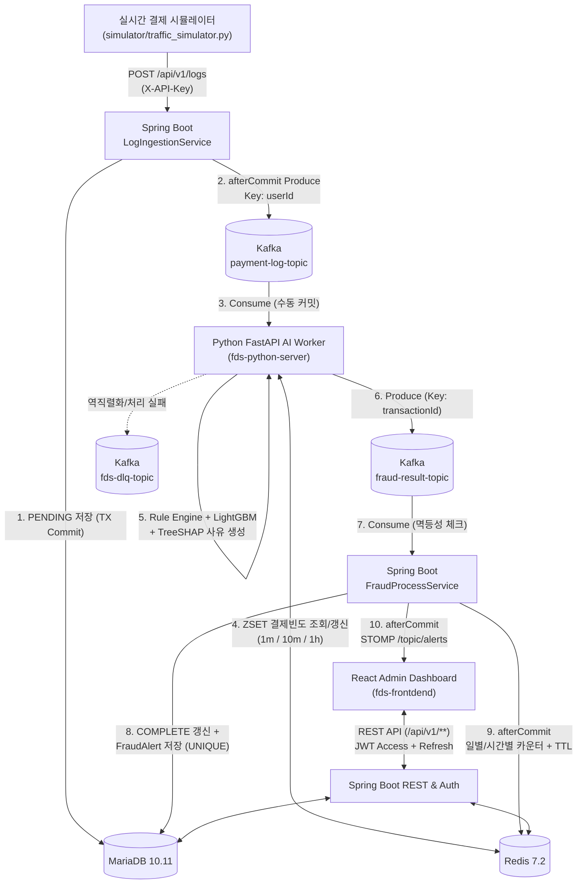
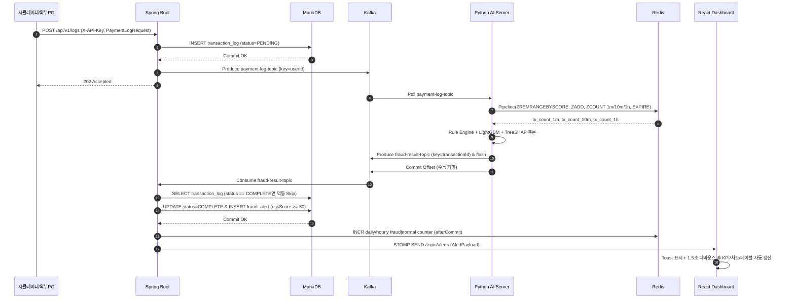
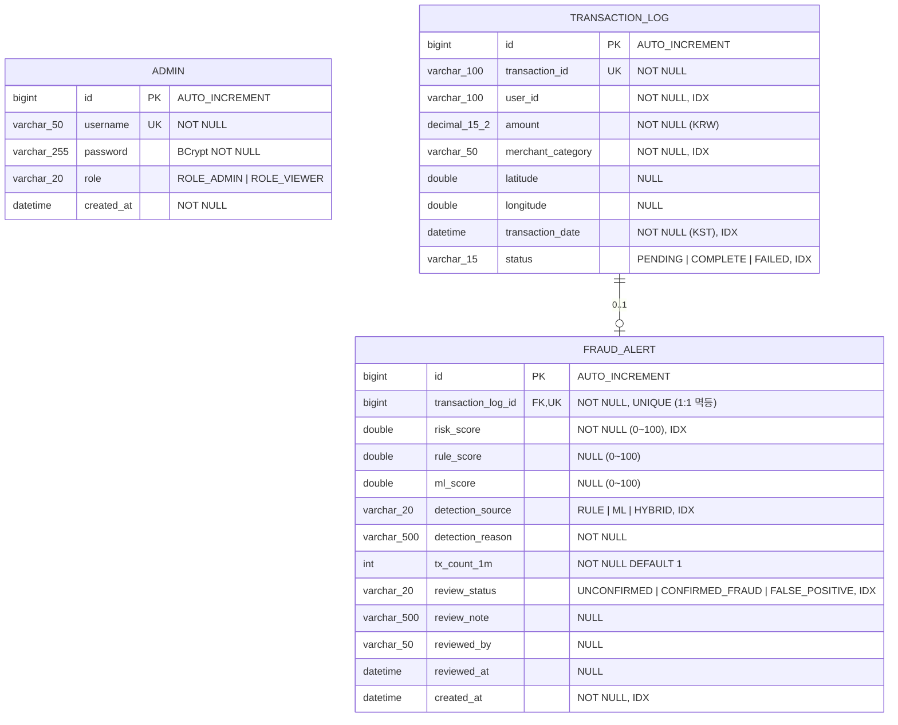

# FDS (Fraud Detection System) 통합 상세 설계서

> **버전**: v2.0 (전면 재설계 기준서)  
> **작성일**: 2026-11-22  
> **대상 저장소**: `d:\fds-core` (기존 3개 서비스 골격 유지 리팩토링 기준)  
> **목표 수준**: 캡스톤·포트폴리오 데모 완성도 중심 (End-to-End 실시간 시연 + 핵심 신뢰성/보안/AI 설명력 확보)

---

## 목차

1. [프로젝트 개요 및 목표 범위](#1-프로젝트-개요-및-목표-범위)
2. [전체 시스템 아키텍처 및 기존 결함 해결](#2-전체-시스템-아키텍처-및-기존-결함-해결)
3. [데이터베이스 ERD 및 Redis 키 설계](#3-데이터베이스-erd-및-redis-키-설계)
4. [Kafka 이벤트 파이프라인 및 신뢰성 설계](#4-kafka-이벤트-파이프라인-및-신뢰성-설계)
5. [AI 모델 및 하이브리드 이상 탐지 파이프라인 설계](#5-ai-모델-및-하이브리드-이상-탐지-파이프라인-설계)
6. [통합 REST API 및 WebSocket(STOMP) 명세](#6-통합-rest-api-및-websocketstomp-명세)
7. [프론트엔드 UX 및 컴포넌트 아키텍처 설계](#7-프론트엔드-ux-및-컴포넌트-아키텍처-설계)
8. [실시간 트래픽 시뮬레이터 및 인프라 설계](#8-실시간-트래픽-시뮬레이터-및-인프라-설계)
9. [단계별 리팩토링 로드맵 및 검증 기준](#9-단계별-리팩토링-로드맵-및-검증-기준)

---

## 1. 프로젝트 개요 및 목표 범위

### 1.1 프로젝트 비전 및 핵심 목표
금융·신용카드 결제 트래픽을 실시간으로 수집하여 **Kafka 기반 비동기 스트림 → Redis 실시간 결제빈도 피처 → Rule Engine + LightGBM 하이브리드 탐지 → MariaDB/Redis 반영 → WebSocket 실시간 알림 및 관리자 대시보드**까지 끊김 없이 동작하는 실시간 이상 거래 탐지 시스템(FDS)을 구축합니다.

### 1.2 핵심 설계 원칙
1. **캡스톤·포트폴리오 데모 완성도 우선**: 불필요한 대규모 엔터프라이즈 인프라(Debezium CDC, Kubernetes 등)는 배제하되, **실제 동작 중 크래시·중복 처리·보안 허점이 없는 단단한 아키텍처**를 구현합니다.
2. **기존 골격 유지 리팩토링**: 기존 3개 서브 프로젝트와 인프라 구성을 유지하면서 계약(Contract)을 일원화하고 구조를 고도화합니다.
3. **단일 기준 문서(Single Source of Truth)**: 모든 DB 스키마, Kafka JSON, REST API, WebSocket Payload, 금액 단위는 본 문서를 기준으로 백엔드·AI·프론트엔드가 100% 일치하도록 관리합니다.
4. **통화 단위 통일 — KRW(원)**: 학습 데이터, 탐지 룰, 시뮬레이터, 백엔드 DB/API, 프론트엔드 UI 모두 **대한민국 원화(KRW, `원`)** 기준으로 통일합니다. *(Kaggle Sparkov 원본 USD 금액은 고정 환율 `1,350원`을 적용해 변환)*

### 1.3 프로젝트 디렉토리 구성 (기존 골격 유지)

| 경로 | 역할 | 기술 스택 | 비고 |
|---|---|---|---|
| `d:\fds-core\FDS-DESIGN.md` | 통합 상세 설계서 (본 문서) | Markdown, Mermaid | 최상위 단일 기준 문서 |
| `d:\fds-core\docker-compose.yml` | 로컬 인프라 오케스트레이션 | MariaDB 10.11, Redis 7.2, Kafka 3.7.0 (KRaft) | 영속 볼륨·Healthcheck 보완 |
| `d:\fds-core\fds-spring-server` | 백엔드 API · 파이프라인 · 알림 서버 | Spring Boot 3.5.16, Java 17, JPA, Security/JWT, WebSocket, Kafka, Redis | 기존 골격 유지 리팩토링 |
| `d:\fds-core\fds-python-server` | AI 추론 · 피처 · 하이브리드 탐지 서버 | Python, FastAPI, `confluent-kafka`, Pandas, LightGBM, `redis-py` | 실제 ML 모델 + Redis 빈도 연동 |
| `d:\fds-core\fds-frontdend` | 관리자 실시간 모니터링 대시보드 | React 19, Vite, TypeScript, Tailwind CSS v4, Recharts, STOMP/SockJS | 기존 폴더명(`fds-frontdend`) 유지 |
| `d:\fds-core\simulator` | 실시간 결제 트래픽 시뮬레이터 *(신규)* | Python (`httpx` / `requests`) | 데모 시연용 스트림 생성 CLI |

### 1.4 핵심 데모 시연 시나리오 (Demo Acceptance Scenarios)

| 시나리오 | 트리거 | 기대 동작 (End-to-End) |
|---|---|---|
| **S1. 정상 결제 스트림** | 시뮬레이터 `--mode mixed` 정상 결제 유입 | `PENDING` → AI 분석(`riskScore < 80`) → `COMPLETE`, 시간대별/일별 정상 카운터 증가, 알람 미생성 |
| **S2. 단시간 연타(Burst) 탐지** | 시뮬레이터 `--mode burst --count 6` (1분 내 동일 사용자 6회) | Redis `ZSET`에서 `tx_count_1m >= 5` 감지 → `R1_BURST_1M` + LightGBM `HYBRID` 판정 → 우측 상단 실시간 Toast 팝업 + 대시보드 KPI/차트/테이블 자동 갱신 |
| **S3. 고액 / 새벽 고위험 탐지** | 150만원 이상 고액 또는 새벽(0~5시) 고위험 업종 결제 유입 | `RULE` 또는 `ML`/`HYBRID` 탐지 + TreeSHAP 기반 구체적 탐지 사유 표시 |
| **S4. 관리자 알람 확인/오탐 처리** | 관리자가 `/alerts` 화면에서 알람 상세 클릭 → 사기 확정 또는 오탐 처리 + 메모 저장 | `review_status` 갱신(`CONFIRMED_FRAUD` / `FALSE_POSITIVE`), 처리자·시각 기록, 대시보드 '미확인 알람' 카운트 즉시 감소 |

---

## 2. 전체 시스템 아키텍처 및 기존 결함 해결

### 2.1 시스템 아키텍처 다이어그램



### 2.2 실시간 결제 탐지 시퀀스 다이어그램



### 2.3 기존 설계·코드 5대 결함 해결 매핑

| # | 기존 결함 | 발생 위험 | 재설계 해결책 |
|---|---|---|---|
| **1** | WebSocket Payload 불일치 (`AlertPayload` vs `useWebSocket.ts`) | 프론트엔드에서 `alert.amount.toLocaleString()` 호출 시 `TypeError` 크래시 | 섹션 6.4의 단일 `AlertPayload` 계약으로 백엔드·프론트엔드 필드 100% 통일 |
| **2** | Python `_on_assign`의 `p.offset = -2` 강제 리셋 | Python 재시작 시 전체 과거 메시지 재소비 → 알람 중복 저장·통계 중복 누적 | `p.offset = -2` 제거, `enable.auto.commit=False` + 처리/발행 확정 후 수동 커밋 적용 |
| **3** | Spring 트랜잭션 경계 혼재 & 멱등성 부재 | DB 롤백 시 Kafka/Redis/WS 불일치, 중복 결과 수신 시 알람 중복 생성 | `TransactionSynchronization.afterCommit()` 분리 + `status == COMPLETE` 가드 + `fraud_alert.transaction_log_id` UNIQUE 제약 |
| **4** | 보안 공백 (`/dashboard/**`, `/ws-fds/**`, `/logs` 무인증 + 평문 시크릿) | 미인증 사용자 대시보드 조회/알림 구독/로그 위조 가능 | 모든 조회 API JWT 필수, RBAC(`ROLE_ADMIN`) 적용, STOMP `ChannelInterceptor` JWT 검증, `/logs` `X-API-Key` 검증, `.env` 환경변수 분리 |
| **5** | 문서↔코드 스펙 불일치 & API 분산 | `/api/auth` vs `/api/v1/*` 혼재, 미사용 API 방치, "Redis 집계" 오표기 | `/api/v1/**` 전면 통일, 중복 컨트롤러(`StatsController`/`DashboardController`) 통합, 단일 설계서 기준 관리 |

---

## 3. 데이터베이스 ERD 및 Redis 키 설계

### 3.1 MariaDB ERD



### 3.2 테이블별 상세 명세 및 기존 스키마 대비 변경점

#### 1) `admin`
- 기존 구조 유지 + `created_at` 컬럼 추가.
- 기본 계정: 서버 기동 시 `DataInitializer`가 환경변수(`FDS_ADMIN_USERNAME`, `FDS_ADMIN_PASSWORD`) 기반으로 초기 `ROLE_ADMIN` 계정 및 데모용 `viewer` (`ROLE_VIEWER`) 계정 생성.

#### 2) `transaction_log`
- 기존 컬럼 유지 (`amount`는 KRW 원화 기준 `DECIMAL(15, 2)`).
- `ProcessStatus` enum 확장: `PENDING`, `COMPLETE`, `FAILED` *(DLQ 격리 시 장애 추적용)*.
- **인덱스 추가**:
  - `idx_tx_date` (`transaction_date DESC`) — 거래 내역 페이징 정렬 최적화
  - `idx_tx_status` (`status`) — `PENDING`/`COMPLETE` 카운트 집계 최적화
  - `idx_tx_user_date` (`user_id`, `transaction_date DESC`) — 사용자별 검색 최적화
  - `idx_tx_category` (`merchant_category`) — 카테고리 필터링 최적화

#### 3) `fraud_alert` (핵심 확장)
- **연관관계 변경**: `@ManyToOne` → **`@OneToOne` + `UNIQUE(transaction_log_id)`** 제약 추가. 한 거래당 최대 1개의 알람만 생성되도록 DB 레벨에서 멱등성을 강제합니다.
- **하이브리드 탐지 메타데이터 추가**:
  - `rule_score` (`DOUBLE`, nullable): Rule Engine 산출 점수 (룰 미적중 시 `null`)
  - `ml_score` (`DOUBLE`, nullable): LightGBM 추론 점수 (모델 Fallback 시 `null`)
  - `detection_source` (`ENUM`: `RULE`, `ML`, `HYBRID`): 최종 판정 출처
  - `tx_count_1m` (`INT`): 탐지 당시 해당 사용자의 최근 1분 결제 빈도 (대시보드 상세 근거 표시용)
  - `detection_reason` (`VARCHAR(500)`): 기존 255 → 500자로 확장 (Rule + TreeSHAP 복합 사유 수용)
- **관리자 확인/오탐 처리 워크플로우 확장** *(기존 `boolean confirmed` 대체)*:
  - `review_status` (`ENUM`: `UNCONFIRMED`, `CONFIRMED_FRAUD`, `FALSE_POSITIVE`, 기본값 `UNCONFIRMED`)
  - `review_note` (`VARCHAR(500)`, nullable): 관리자 판정 메모
  - `reviewed_by` (`VARCHAR(50)`, nullable): 처리한 관리자 `username`
  - `reviewed_at` (`DATETIME`, nullable): 처리 일시 (KST)
- **인덱스 추가**:
  - `idx_alert_created_at` (`created_at DESC`)
  - `idx_alert_review_status` (`review_status`, `created_at DESC`)
  - `idx_alert_risk_score` (`risk_score DESC`)

### 3.3 Redis 키 네임스페이스 및 TTL 정책

모든 Redis 키는 `fds:` 프리픽스를 사용하며, **메모리 무한 증가 방지를 위해 모든 키에 TTL을 강제**합니다.

| 도메인 | 키 패턴 | 타입 | 값 / 구조 | TTL | 사용 주체 |
|---|---|---|---|---|---|
| **일별 통계** | `fds:stats:daily:{yyyy-MM-dd}:fraud` | String | 일별 사기 탐지 건수 (`INCR`) | 30일 | Spring (`FraudProcessService`, `DashboardService`) |
| **일별 통계** | `fds:stats:daily:{yyyy-MM-dd}:normal` | String | 일별 정상 결제 건수 (`INCR`) | 30일 | Spring |
| **시간대별 통계** | `fds:stats:hourly:{yyyy-MM-dd:HH}:fraud` | String | 시간대별 사기 건수 (`INCR`) | 48시간 | Spring (최근 24시간 차트) |
| **시간대별 통계** | `fds:stats:hourly:{yyyy-MM-dd:HH}:normal` | String | 시간대별 정상 건수 (`INCR`) | 48시간 | Spring (최근 24시간 차트) |
| **실시간 결제빈도** | `fds:vel:user:{userId}` | ZSET | `score=epoch_sec`, `member=transactionId` | 4,200초 (70분) | Python (`feature_store.py`) |
| **인증 Refresh** | `fds:auth:refresh:{username}` | String | 발급된 Refresh Token | 7일 | Spring (`AuthService`) |
| **로그아웃 블랙리스트** | `fds:auth:blacklist:{jti}` | String | `"logout"` | Access 잔여 만료시간 | Spring (`JwtAuthenticationFilter`) |

> **시간 기준 통일**: 모든 통계 키의 `{yyyy-MM-dd}` 및 `{yyyy-MM-dd:HH}`는 `ZoneId.of("Asia/Seoul")` (KST) 기준으로 생성합니다.

---

## 4. Kafka 이벤트 파이프라인 및 신뢰성 설계

### 4.1 토픽 명세

| 토픽명 | Producer | Consumer (Group ID) | Partition Key | 파티션 수 (로컬) | 용도 |
|---|---|---|---|---|---|
| `payment-log-topic` | Spring Boot | Python AI (`fds-python-group`) | **`userId`** | 3 *(권장)* | 수집된 결제 로그 비동기 전달 |
| `fraud-result-topic` | Python AI | Spring Boot (`fds-spring-group`) | `transactionId` | 3 *(권장)* | AI/하이브리드 분석 결과 반환 |
| `fds-dlq-topic` | Python AI / Spring Boot | 운영 모니터링 / 수동 재처리 | `transactionId` | 1 | 역직렬화 오류·재시도 초과 메시지 격리 |

> **파티션 키 변경 핵심 이유**: 기존 `payment-log-topic`은 `transactionId`를 키로 사용하여 동일 사용자의 연속 결제가 서로 다른 파티션으로 분산될 수 있었습니다. 파티션 키를 **`userId`**로 변경하면 동일 사용자의 결제가 항상 동일 파티션에서 순서대로 처리되어 Redis 결제빈도(`tx_count_1m/10m/1h`)의 정확성이 보장됩니다.

### 4.2 이벤트 JSON 계약 (Spring ↔ Python)

#### 1) `payment-log-topic` (Spring → Python)
```json
{
  "transactionId": "tx-550e8400-e29b-41d4-a716-446655440000",
  "userId": "user-1042",
  "amount": 1850000.00,
  "merchantCategory": "shopping_net",
  "transactionDate": "2026-11-22T02:15:30+09:00",
  "latitude": 37.5665,
  "longitude": 126.9780
}
```

#### 2) `fraud-result-topic` (Python → Spring)
```json
{
  "transactionId": "tx-550e8400-e29b-41d4-a716-446655440000",
  "riskScore": 95.0,
  "ruleScore": 95.0,
  "mlScore": 87.42,
  "detectionSource": "HYBRID",
  "detectionReason": "[RULE] 단시간 다중 결제 (1분 내 5회) | [ML] 주요 요인: 고액 결제, 새벽 시간대",
  "txCount1m": 5,
  "txCount10m": 6,
  "txCount1h": 8,
  "analyzedAt": "2026-11-22T02:15:30.142+09:00"
}
```

| 필드명 | 타입 | 제약 | 설명 |
|---|---|---|---|
| `transactionId` | `String` | Required | 원본 거래 고유 ID |
| `riskScore` | `Double` | `0.0 ~ 100.0` | 최종 하이브리드 위험 스코어 |
| `ruleScore` | `Double \| null` | `0.0 ~ 100.0` | Rule Engine 점수 (미적중 시 `null`) |
| `mlScore` | `Double \| null` | `0.0 ~ 100.0` | LightGBM 모델 점수 (Fallback 시 `null`) |
| `detectionSource` | `String` | `RULE \| ML \| HYBRID \| NONE` | 판정 출처 (`riskScore < 80`이면 `NONE`) |
| `detectionReason` | `String` | Max 500자 | 규칙 및 TreeSHAP 기반 한글 탐지 사유 *(전 구간 필드명 통일)* |
| `txCount1m` | `Integer` | `>= 1` | 분석 시점 최근 1분 결제 횟수 |
| `txCount10m` | `Integer` | `>= 1` | 분석 시점 최근 10분 결제 횟수 |
| `txCount1h` | `Integer` | `>= 1` | 분석 시점 최근 1시간 결제 횟수 |
| `analyzedAt` | `String` | ISO-8601 (KST) | AI 분석 완료 시각 |

#### 3) `fds-dlq-topic` (장애 격리 포맷)
```json
{
  "sourceTopic": "payment-log-topic",
  "failedAt": "2026-11-22T02:15:31+09:00",
  "errorType": "ValidationError",
  "errorMessage": "amount must be greater than 0",
  "rawPayload": "{...}"
}
```

### 4.3 신뢰성·트랜잭션 경계·멱등성 설계

1. **Spring Producer (`LogIngestionService`)**:
   - `@Transactional` 내에서 `TransactionLog(PENDING)`을 먼저 저장합니다.
   - `TransactionSynchronizationManager.registerSynchronization(afterCommit)` 콜백에서 `kafkaProducerService.sendPaymentLog(dto)`를 호출하여 **DB 커밋이 확정된 거래만 Kafka로 발행**합니다.
   - 기존 `kafkaTemplate.flush()` 매건 동기 호출은 처리량 병목이 되므로 제거하고, `acks=all`, `retries=3`, `linger.ms=5`, `whenComplete` 비동기 콜백 로깅을 사용합니다.

2. **Python Consumer (`kafka_client.py`)**:
   - **기존 `_on_assign`의 `p.offset = -2` 강제 지정 완전 제거** (커밋된 오프셋이 있으면 이어서 소비, 신규 그룹 최초 기동 시에만 `auto.offset.reset = earliest` 적용).
   - `enable.auto.commit = False` 설정 후, 단일 메시지 **분석 → `fraud-result-topic` 발행 → `producer.flush(timeout=5)` 성공 확인 → `consumer.commit(message=msg)`** 순서로 At-Least-Once 보장.
   - JSON 파싱/Pydantic 검증 실패 또는 3회 재시도 후에도 처리 불가한 메시지는 `fds-dlq-topic`으로 전송 후 오프셋 커밋(Poison Pill로 인한 컨슈머 무한 블로킹 방지).

3. **Spring Consumer (`KafkaResultListener` & `FraudProcessService`)**:
   - **1차 멱등성 가드**: `TransactionLog.status == COMPLETE`이면 이미 처리 완료된 중복 메시지로 판단하고 경고 로그 후 즉시 반환합니다.
   - **2차 멱등성 가드**: `fraud_alert.transaction_log_id` `UNIQUE` 제약조건으로 동시성 중복 삽입을 차단합니다.
   - **부수효과 분리**: `FraudAlert` 저장 및 `COMPLETE` 업데이트 커밋이 완료된 후(`afterCommit`), Redis 일별/시간대별 카운터 증가 및 WebSocket `/topic/alerts` 브로드캐스트를 실행합니다.

---

## 5. AI 모델 및 하이브리드 이상 탐지 파이프라인 설계

### 5.1 데이터셋 추천 및 매핑: Kaggle Sparkov (`kartik2112/fraud-detection`)

#### 선정 이유
- 기존 `TransactionLog` 도메인 모델(`transactionId`, `userId`, `amount`, `merchantCategory`, `transactionDate`, `latitude`, `longitude`)과 컬럼 구조가 1:1로 일치합니다.
- 대표적인 대안인 ULB `creditcard.csv`는 PCA 익명화 변수(`V1~V28`)만 존재하여 업종·사용자·시간대 기반 실시간 API 데모 및 설명력 확보에 부적합합니다.

#### 컬럼 매핑 및 KRW 환산
| Sparkov 원본 컬럼 | FDS 표준 필드 | 변환 규칙 |
|---|---|---|
| `trans_num` | `transactionId` | 문자열 그대로 사용 |
| `cc_num` | `userId` | `f"user-{str(cc_num)[-6:]}"` 형식 마스킹/문자열화 |
| `amt` | `amount` | **`round(amt * 1350, 0)` (KRW 원화 환산)** |
| `category` | `merchantCategory` | 소문자 정규화 (`grocery_pos`, `shopping_net`, `misc_net`, `gas_transport`, `food_dining`, `entertainment`, `travel`, `health_fitness`, `home`, `kids_pets`, `personal_care`, `shopping_pos`, `misc_pos`, `grocery_net` + 확장 고위험 업종 `gambling`, `crypto`) |
| `trans_date_trans_time` | `transactionDate` | ISO-8601 KST(`+09:00`) 타임스탬프 |
| `merch_lat` / `merch_long` | `latitude` / `longitude` | 실수 좌표 유지 *(이동거리 계산에는 미사용)* |
| `is_fraud` | 타겟 레이블 (`y`) | `0` (정상) / `1` (사기) |

#### 재현성 보완 (합성 데이터 생성기 병행)
- Kaggle 대용량 CSV(`fraudTrain.csv`, 약 350MB)를 로컬에 다운로드할 수 있는 경우 실제 데이터로 학습합니다.
- 클론 직후 CSV 없이도 누구나 즉시 학습·평가·데모할 수 있도록 `fds-python-server/training/generate_synthetic_data.py`를 제공하여 Sparkov와 동일한 스키마·불균형 비율(~1.5%)·사기 패턴(고액, 새벽 온라인/고위험 업종, 단시간 연타 Burst)을 가진 학습 데이터(예: 100,000건)를 생성할 수 있게 설계합니다.

### 5.2 피처 엔지니어링 (이동거리 제외 · Redis 결제빈도 중심)

총 **12개 입력 피처**를 오프라인 학습과 온라인 서빙에서 **동일한 전처리 모듈(`app/features.py`)**로 생성하여 Train–Serving Skew를 제거합니다.

| # | 피처명 | 타입 | 설명 | 이동거리 포함 여부 |
|---|---|---|---|---|
| 1 | `amount` | `float` | 거래 금액 (KRW) | - |
| 2 | `log_amount` | `float` | `np.log1p(amount)` (고액 편차 정규화) | - |
| 3 | `merchant_category_id` | `int` (Category) | 고정 카테고리 사전(`category_vocab.json`) 기반 정수 인코딩 (미등록 업종은 `UNKNOWN=0`) | - |
| 4 | `tx_hour` | `int` (0~23) | KST 기준 거래 시각 | - |
| 5 | `tx_dow` | `int` (0~6) | KST 기준 요일 (0=월 ~ 6=일) | - |
| 6 | `is_night` | `int` (0/1) | 새벽 시간대(`0 <= tx_hour <= 5`) 여부 | - |
| 7 | `is_weekend` | `int` (0/1) | 주말(`tx_dow >= 5`) 여부 | - |
| 8 | `latitude` | `float` | 거래 위치 위도 (원시값 참고용) | **이동거리 미계산** |
| 9 | `longitude` | `float` | 거래 위치 경도 (원시값 참고용) | **이동거리 미계산** |
| 10 | `tx_count_1m` | `int` | **최근 1분간 해당 `userId` 결제 횟수 (현재 건 포함)** | **Redis ZSET** |
| 11 | `tx_count_10m` | `int` | **최근 10분간 해당 `userId` 결제 횟수 (현재 건 포함)** | **Redis ZSET** |
| 12 | `tx_count_1h` | `int` | **최근 1시간 내 해당 `userId` 결제 횟수 (현재 건 포함)** | **Redis ZSET** |

### 5.3 Redis 실시간 결제빈도 피처 스토어 (`app/feature_store.py`)

```python
# Redis Pipeline 기반 원자적·멱등적 결제빈도 산출 (단일 RTT)
key = f"fds:vel:user:{user_id}"
pipe = redis_client.pipeline()
pipe.zremrangebyscore(key, "-inf", tx_epoch - 3600)          # 1시간 초과 이력 정리
pipe.zadd(key, {transaction_id: tx_epoch})                   # 현재 거래 등록 (동일 txId 멱등)
pipe.zcount(key, tx_epoch - 60, tx_epoch)                    # tx_count_1m
pipe.zcount(key, tx_epoch - 600, tx_epoch)                   # tx_count_10m
pipe.zcount(key, tx_epoch - 3600, tx_epoch)                  # tx_count_1h
pipe.expire(key, 4200)                                       # TTL 70분 갱신
_, _, count_1m, count_10m, count_1h, _ = pipe.execute()
```

- **Redis 일시 장애 시 Fallback**: Redis 연결 실패 시 예외로 파이프라인이 멈추지 않고 경고 로그 출력 후 기본값 `(1, 1, 1)`로 추론을 계속 진행합니다.
- **오프라인 학습 정합성**: 학습 시에도 `df.sort_values(["userId", "transactionDate"])` 후 각 사용자 그룹별 `1min`, `10min`, `1h` 시간 기반 롤링 카운트를 산출하여 서빙 시점의 `ZCOUNT` 정의와 100% 일치시킵니다.

### 5.4 모델 추천 및 학습 파이프라인: LightGBM (`LGBMClassifier`)

- **선정 이유**:
  1. 건당 추론 속도 **< 5ms**로 실시간 Kafka 스트림 처리에 최적화
  2. `scale_pos_weight = count(normal) / count(fraud)`로 극심한 클래스 불균형 대응
  3. 내장 `pred_contrib=True` (TreeSHAP)를 통해 별도 무거운 라이브러리 없이 각 거래의 **상위 기여 피처 2개**를 즉시 추출해 한글 탐지 사유 생성
- **학습/검증 분할**: 랜덤 셔플 대신 **시계열 기준 분할 (앞 80% Train / 뒤 20% Test)**로 데이터 누수(Data Leakage) 방지
- **평가 지표 & 산출물**:
  - 저장 경로: `fds-python-server/models/lgbm_fraud_v1.joblib`, `fds-python-server/models/metadata.json`
  - `metadata.json` 기록 항목: `model_version`, `trained_at`, `dataset_source`, `feature_names`, `category_vocab`, `metrics` (`pr_auc`, `roc_auc`, `f1_at_0_8`, `recall_at_fpr_1pct`)

### 5.5 3-Layer 하이브리드 탐지 엔진 (`app/fraud_detector.py`)

#### Layer 1 — Rule Engine (명시적 정책 룰)
| 룰 코드 | 조건 (KRW 기준) | `ruleScore` | 사유 템플릿 |
|---|---|---|---|
| `R1_BURST_1M` | `tx_count_1m >= 5` | `95.0` | `단시간 다중 결제 (1분 내 {tx_count_1m}회)` |
| `R2_BURST_10M` | `tx_count_10m >= 12` | `88.0` | `단기 과다 결제 빈도 (10분 내 {tx_count_10m}회)` |
| `R3_HIGH_AMOUNT` | `amount >= 1,500,000` | `90.0` | `초고액 결제 ({amount:,.0f}원)` |
| `R4_NIGHT_HIGH_RISK` | `is_night == 1` AND `merchantCategory in {shopping_net, misc_net, gambling, crypto}` AND `amount >= 300,000` | `85.0` | `새벽 고위험 업종 결제 ({merchantCategory}, {amount:,.0f}원)` |

- 여러 룰이 동시 적중하면 **가장 높은 `ruleScore`**를 채택하고 적중된 모든 룰 사유를 병기합니다.

#### Layer 2 — LightGBM ML Layer
- `prob = model.predict_proba(X)[0][1]` → `mlScore = round(prob * 100.0, 2)`
- `contribs = model.predict(X, pred_contrib=True)[0][:-1]` → 양(+)의 기여도가 가장 큰 상위 2개 피처를 한글 레이블로 매핑 (예: `tx_count_1m` → `"1분 결제빈도 급증"`, `amount` → `"고액 결제"`, `is_night` → `"새벽 시간대"`, `merchant_category_id` → `"고위험 업종"`).

#### Layer 3 — Hybrid Score 결합 및 판정 정책
- **최종 점수**: `finalRiskScore = max(ruleScore or 0.0, mlScore or 0.0)`
- **이상 탐지 임계치**: `finalRiskScore >= 80.0` (환경변수 `FDS_FRAUD_THRESHOLD=80.0`으로 설정 가능)
- **`detectionSource` 결정 규칙**:
  - `ruleScore >= 80.0` AND `mlScore >= 80.0` → **`HYBRID`**
  - `ruleScore >= 80.0` AND `(mlScore is None or mlScore < 80.0)` → **`RULE`**
  - `(ruleScore is None or ruleScore < 80.0)` AND `mlScore >= 80.0` → **`ML`**
  - `finalRiskScore < 80.0` → **`NONE`** (정상 거래)
- **안전 장치 (Model Fallback)**: 모델 파일이 없거나 추론 예외 발생 시 `mlScore = None`으로 처리하고 Rule Engine 단독으로 정상 응답을 반환합니다.

### 5.6 Python 서버 내부 모듈 구조 (리팩토링 후)

```text
fds-python-server/
├── app/
│   ├── main.py               # FastAPI lifespan (모델 로드 + Redis/Kafka 수명주기 관리), /health (모델/Kafka 상태 포함)
│   ├── config.py             # 환경변수 설정 (Kafka, Redis, Model 경로, 임계치)
│   ├── schemas.py            # Pydantic PaymentLogInput / FraudResultOutput
│   ├── feature_store.py      # ✨ 신규: Redis ZSET 실시간 결제빈도 조회/갱신
│   ├── features.py           # ✨ 신규: 오프라인/온라인 공용 피처 전처리 모듈
│   ├── rule_engine.py        # ✨ 신규: 명시적 정책 룰 4종
│   ├── model_service.py      # ✨ 신규: LightGBM 모델 로더 + 추론 + TreeSHAP 사유 생성
│   ├── fraud_detector.py     # 하이브리드 오케스트레이터 (FeatureStore + RuleEngine + ModelService)
│   └── kafka_client.py       # 수동 커밋 Consumer + Producer + DLQ 발행
├── training/
│   ├── generate_synthetic_data.py  # ✨ 신규: Sparkov 스키마 호환 합성 데이터 생성기
│   └── train_lgbm.py               # ✨ 신규: LightGBM 학습·시계열 검증·아티팩트 저장 스크립트
├── models/                   # 학습된 모델 아티팩트 (lgbm_fraud_v1.joblib, metadata.json)
└── requirements.txt          # lightgbm, scikit-learn, joblib, redis 추가
```

---

## 6. 통합 REST API 및 WebSocket(STOMP) 명세

### 6.1 공통 정책
- **Base Prefix**: 모든 REST API를 `/api/v1/**`로 통일 *(기존 `/api/auth/login` → `/api/v1/auth/login`, `/api/v1/stats/*`는 `/api/v1/dashboard/*`로 통합)*.
- **인증 방식**:
  - 대시보드 API: `Authorization: Bearer <accessToken>` (JWT, 만료 30분 / Refresh 7일)
  - 결제 로그 수집 API(`POST /api/v1/logs`): `X-API-Key: <FDS_INGEST_API_KEY>` 헤더 검증
  - CORS: 환경변수 `FDS_CORS_ORIGINS` (기본값 `http://localhost:5173`) 화이트리스트 적용
- **표준 에러 응답 (`@RestControllerAdvice`)**:
  ```json
  {
    "code": "INVALID_INPUT",
    "message": "amount는 0보다 커야 합니다.",
    "status": 400,
    "timestamp": "2026-11-22T22:30:00+09:00",
    "path": "/api/v1/logs"
  }
  ```

### 6.2 REST API 엔드포인트 목록

#### A. 인증 API (`/api/v1/auth`)
| 메서드 | 경로 | 권한 | 요청 / 응답 요약 |
|---|---|---|---|
| `POST` | `/api/v1/auth/login` | 공개 | Req: `{ username, password }` → Res: `{ accessToken, refreshToken, username, role }` (Refresh Token을 Redis 저장) |
| `POST` | `/api/v1/auth/refresh` | 공개 | Req: `{ refreshToken }` → Redis 저장 토큰과 일치 검증 후 새 `{ accessToken, refreshToken }` 반환 (Token Rotation) |
| `POST` | `/api/v1/auth/logout` | 인증 | Redis Refresh 삭제 + 현재 Access Token `jti`를 잔여 만료시간만큼 블랙리스트 등록 (`204 No Content`) |
| `GET` | `/api/v1/auth/me` | 인증 | Res: `{ username, role }` |

#### B. 결제 로그 수집 API (`/api/v1/logs`)
| 메서드 | 경로 | 권한 | 요청 / 응답 요약 |
|---|---|---|---|
| `POST` | `/api/v1/logs` | `X-API-Key` | `@Valid PaymentLogRequestDto` (`transactionId`, `userId`, `amount > 0`, `merchantCategory`, `transactionDate` ISO-8601, `latitude`, `longitude`) → `202 Accepted` `{ transactionId, status: "PENDING" }` |

#### C. 대시보드 통계 API (`/api/v1/dashboard`)
| 메서드 | 경로 | 권한 | 응답 JSON 스펙 |
|---|---|---|---|
| `GET` | `/api/v1/dashboard/summary` | 인증 | `{ todayFraudCount, todayNormalCount, todayTotalCount, todayFraudRatio, unconfirmedAlertCount, pendingCount, completeCount }` |
| `GET` | `/api/v1/dashboard/hourly-traffic` | 인증 | 최근 24시간(KST, 24개 버킷) 배열: `[{ hour: "2026-11-22T21:00", label: "21시", normalCount: 120, fraudCount: 4 }, ...]` *(Redis `fds:stats:hourly:*` MGET 일괄 조회)* |
| `GET` | `/api/v1/dashboard/fraud-by-category` | 인증 | `[{ category: "shopping_net", count: 18 }, ...]` *(MariaDB `fraud_alert` JOIN `transaction_log` GROUP BY, 건수 내림차순)* |

#### D. 거래 내역 API (`/api/v1/transactions`)
| 메서드 | 경로 | 권한 | 파라미터 및 응답 |
|---|---|---|---|
| `GET` | `/api/v1/transactions` | 인증 | Query: `page=0`, `size=10`, `status` (`PENDING\|COMPLETE\|FAILED`), `isFraud` (`true\|false`), `category`, `keyword` (`transactionId` 또는 `userId` 부분 검색) → `Page<TransactionResponseDto>` |
| `GET` | `/api/v1/transactions/{transactionId}` | 인증 | 거래 상세 + 연결된 알람 정보(`alert: FraudAlertSummary \| null`) 반환 |

**`TransactionResponseDto`**:
```json
{
  "id": 101,
  "transactionId": "tx-...",
  "userId": "user-1042",
  "amount": 1850000,
  "merchantCategory": "shopping_net",
  "latitude": 37.5665,
  "longitude": 126.9780,
  "status": "COMPLETE",
  "isFraud": true,
  "riskScore": 95.0,
  "detectionSource": "HYBRID",
  "reviewStatus": "UNCONFIRMED",
  "createdAt": "2026-11-22T02:15:30"
}
```

#### E. 이상 탐지 알람 워크플로우 API (`/api/v1/alerts`)
| 메서드 | 경로 | 권한 | 요청 / 응답 요약 |
|---|---|---|---|
| `GET` | `/api/v1/alerts` | 인증 | Query: `page=0`, `size=20`, `reviewStatus` (`UNCONFIRMED\|CONFIRMED_FRAUD\|FALSE_POSITIVE`), `detectionSource` (`RULE\|ML\|HYBRID`), `sort=createdAt,desc` → `Page<FraudAlertResponseDto>` |
| `GET` | `/api/v1/alerts/{alertId}` | 인증 | 알람 단건 상세 (거래 정보 + `ruleScore`, `mlScore`, `txCount1m`, `detectionReason`, 리뷰 이력) |
| `PATCH` | `/api/v1/alerts/{alertId}/review` | **`ROLE_ADMIN`** | Req: `{ reviewStatus: "CONFIRMED_FRAUD" \| "FALSE_POSITIVE", reviewNote: "카드 소유주 확인 완료 - 도용 확정" }` → 갱신된 `FraudAlertResponseDto` 반환 |

### 6.3 보안 접근 제어 매트릭스 (`SecurityConfig`)

| 경로 패턴 | 접근 정책 |
|---|---|
| `/api/v1/auth/login`, `/api/v1/auth/refresh` | `permitAll()` |
| `/api/v1/logs` | `ApiKeyAuthFilter` (`X-API-Key` 검증) |
| `/ws-fds/**` | HTTP 핸드쉐이크 허용 + **STOMP `CONNECT` 시 `StompChannelInterceptor` JWT 검증 필수** |
| `PATCH /api/v1/alerts/*/review` | `hasRole("ADMIN")` (`ROLE_VIEWER`는 읽기 전용) |
| 그 외 모든 `/api/v1/**` | `authenticated()` (JWT + Redis 블랙리스트 검사) |

### 6.4 WebSocket (STOMP) 통일 명세

- **Endpoint**: `http://localhost:8080/ws-fds` (SockJS 지원)
- **인증**: STOMP `CONNECT` 헤더 `Authorization: Bearer <accessToken>` → `StompChannelInterceptor`에서 `JwtProvider.validate()` 및 블랙리스트 검증 실패 시 연결 거부
- **Subscribe Topic**: `/topic/alerts`
- **통일 Payload (`AlertPayload` ↔ Frontend `FraudAlert`)**:
```json
{
  "alertId": 42,
  "transactionId": "tx-550e8400-e29b-41d4-a716-446655440000",
  "userId": "user-1042",
  "amount": 1850000,
  "merchantCategory": "shopping_net",
  "riskScore": 95.0,
  "ruleScore": 95.0,
  "mlScore": 87.42,
  "detectionSource": "HYBRID",
  "detectionReason": "[RULE] 단시간 다중 결제 (1분 내 5회) | [ML] 주요 요인: 고액 결제, 새벽 시간대",
  "txCount1m": 5,
  "reviewStatus": "UNCONFIRMED",
  "createdAt": "2026-11-22T02:15:30"
}
```

---

## 7. 프론트엔드 UX 및 컴포넌트 아키텍처 설계 (`fds-frontdend`)

### 7.1 라우팅 및 페이지 구조

```text
/                 → /dashboard (로그인 상태) 또는 /login (미로그인)
/login            → LoginPage (공개)
/dashboard        → DashboardLayout (ProtectedRoute)
  ├── /dashboard      → DashboardPage (실시간 모니터링 메인)
  ├── /alerts         → AlertsPage (이상 탐지 알람 관리 & 확인/오탐 처리)
  └── /transactions   → TransactionsPage (전체 결제 내역 검색·필터·상세)
```

### 7.2 페이지별 화면 구성

#### 1) 공통 레이아웃 (`DashboardLayout`)
- **좌측 사이드바**: `실시간 대시보드`, `이상 탐지 알람`(미확인 건수 빨간 뱃지 표시), `전체 결제 내역`, 하단 로그아웃(`/api/v1/auth/logout` 호출)
- **상단 네비게이션바**: 현재 페이지 제목, **WebSocket 연결 상태 인디케이터**(초록: 실시간 연결됨 / 주황: 재연결 중), 실제 로그인 사용자명 & Role 뱃지 (`/api/v1/auth/me`)
- **글로벌 실시간 Toast (`ToastContainer`)**: `/topic/alerts` 수신 시 우측 상단 슬라이드 인 (`detectionSource` 뱃지 + 거래 금액(원) + 위험 스코어 + 탐지 사유 요약 + 클릭 시 해당 알람 상세 모달 열기)

#### 2) 실시간 대시보드 (`/dashboard`)
- **상단 KPI 카드 4종**:
  1. 오늘 이상 탐지 건수 (+ 오늘 사기 비율 `%`)
  2. 미확인 알람 건수 (`UNCONFIRMED` — 클릭 시 `/alerts?reviewStatus=UNCONFIRMED` 이동)
  3. 분석 대기 중 (`PENDING`)
  4. 전체 분석 완료 (`COMPLETE`)
- **중단 시각화 차트 2종** (12-column 그리드: 7 : 5 비율):
  - **좌측 (7/12) — 최근 24시간 시간대별 트래픽 차트** (`HourlyTrafficChart.tsx`, Recharts `ComposedChart` / `AreaChart` + `Bar`): 시간대별 정상 거래(인디고) vs 이상 거래(레드) 추이
  - **우측 (5/12) — 카테고리별 이상 결제 도넛 차트** (`FraudPieChart.tsx`): MariaDB 집계 기반 카테고리별 비율 *(기존 "Redis 집계" 오표기 수정)*
- **하단 — 최근 결제 내역 테이블** (`TransactionTable.tsx`, 최근 10건 요약 + "전체 보기 →" 링크)

#### 3) 이상 탐지 알람 관리 (`/alerts`)
- **상단 상태 탭**: `전체` / `미확인 (UNCONFIRMED)` / `사기 확정 (CONFIRMED_FRAUD)` / `오탐 (FALSE_POSITIVE)` + `탐지 소스` 필터 (`RULE`, `ML`, `HYBRID`)
- **알람 테이블**: 거래 ID, 사용자 ID, 금액(원), 카테고리, **위험 스코어 게이지**, 탐지 소스 뱃지, 1분 결제빈도, 상태 뱃지, 탐지 시각
- **알람 상세 & 처리 모달 (`AlertDetailModal.tsx`)**:
  - 거래 상세 정보 + `Rule Score` vs `ML Score` 비교 바 + `txCount1m` 표시 + 탐지 사유 전문
  - **`ROLE_ADMIN` 전용 액션 영역**: 판정 메모 입력창 + `[사기 확정]` / `[오탐 처리]` 버튼 (`ROLE_VIEWER`는 읽기 전용 안내 표시)

#### 4) 전체 결제 내역 (`/transactions`)
- **검색·필터 바**: 거래 ID / 사용자 ID 키워드 검색, 상태(`PENDING`/`COMPLETE`), 사기 여부(`전체`/`사기`/`정상`), 카테고리 필터
- 행 클릭 시 거래 상세 모달 표시 (사기 거래인 경우 탐지 점수·사유 바로 확인)

### 7.3 실시간 자동 갱신 & 인증 갱신 아키텍처
- **실시간 자동 갱신**: `DashboardLayout`이 `useWebSocket`으로 알림을 수신하면 React Context(`RealtimeAlertContext`)의 `refreshTick` 카운터를 **1.5초 디바운스**하여 증가 → 대시보드 KPI·시간대별 차트·도넛 차트·테이블·미확인 뱃지가 새로고침 없이 자동 동기화됩니다. *(Burst 시나리오에서 1초에 5건이 쏟아져도 API 폭주를 방지)*
- **JWT 자동 Refresh**: `axiosInstance` Response Interceptor에서 `401` 수신 시 `/api/v1/auth/refresh`를 1회 호출(동시 요청은 큐에 대기)해 새 `accessToken`으로 원요청을 재시도하며, Refresh 실패 시에만 토큰 삭제 후 `/login`으로 이동합니다.

---

## 8. 실시간 트래픽 시뮬레이터 및 인프라 설계

### 8.1 실시간 결제 트래픽 시뮬레이터 (`simulator/traffic_simulator.py`)

캡스톤 발표·포트폴리오 시연 시 대시보드가 살아 움직이는 모습을 즉시 재현할 수 있는 CLI 도구입니다.

```bash
# 1. 혼합 실시간 스트림 (초당 2건, 60초, 정상 85% + 사기 패턴 15%)
python simulator/traffic_simulator.py --mode mixed --tps 2 --duration 60

# 2. 단시간 연타(Burst) 시연 (동일 사용자 1분 내 6건 연속 발송 → R1_BURST_1M + HYBRID 즉시 트리거)
python simulator/traffic_simulator.py --mode burst --user-id user-demo-burst --count 6 --interval 0.5

# 3. 고액 / 새벽 고위험 단건 시나리오 시연
python simulator/traffic_simulator.py --mode scenario --type high-amount
python simulator/traffic_simulator.py --mode scenario --type night-risk

# 4. 실제 Kaggle Sparkov 테스트 CSV 재생 모드
python simulator/traffic_simulator.py --mode csv --file data/fraudTest.csv --tps 3 --limit 200
```

- 모든 요청에 `X-API-Key` 헤더를 자동 포함하고, 콘솔에 발송 건수·시나리오 유형·응답 상태(`202 Accepted`)를 실시간 출력합니다.

### 8.2 Docker Compose 및 환경변수 설계

- **`docker-compose.yml` 보완 사항**:
  - `mariadb_data`, `redis_data`, `kafka_data` **Named Volume** 추가로 컨테이너 재시작 시 데이터 유실 방지
  - 각 서비스별 `healthcheck` 정의 (MariaDB `healthcheck.sh`, Redis `redis-cli ping`, Kafka 브로커 리스닝 체크)
  - `KAFKA_NUM_PARTITIONS: 3` 기본 파티션 설정 (`userId` 키 기반 병렬/순서 처리)
- **환경변수 분리 (`.env.example` 최상위 제공, `.env`는 `.gitignore` 유지)**:
  ```env
  # MariaDB
  MARIADB_ROOT_PASSWORD=rootpassword
  MARIADB_DATABASE=fds_db
  MARIADB_USER=fds_user
  MARIADB_PASSWORD=fdspassword

  # Redis & Kafka
  REDIS_HOST=localhost
  REDIS_PORT=6379
  KAFKA_BOOTSTRAP_SERVERS=localhost:9092

  # Spring Security & Auth
  JWT_SECRET=<Base64-256bit-secret>
  FDS_INGEST_API_KEY=fds-demo-api-key-change-me
  FDS_ADMIN_USERNAME=admin
  FDS_ADMIN_PASSWORD=admin1234!
  FDS_CORS_ORIGINS=http://localhost:5173

  # AI / Detection
  FDS_FRAUD_THRESHOLD=80.0
  FDS_MODEL_PATH=models/lgbm_fraud_v1.joblib
  ```

---

## 9. 단계별 리팩토링 로드맵 및 검증 기준

기존 코드 골격을 유지하면서 아래 4개 Phase 순서대로 점진적 리팩토링 및 구현을 진행합니다.

### Phase 1 — 인프라 정리 & Spring Boot 백엔드 리팩토링 (`fds-spring-server`) ✅ 완료
- [x] `docker-compose.yml` 볼륨·Healthcheck·파티션 설정 보완 및 최상위 `.env.example` 작성
- [x] JPA 엔티티 확장 (`FraudAlert` 1:1 UNIQUE + 하이브리드/리뷰 컬럼, `TransactionLog` 인덱스/`FAILED` 상태, `Admin` `createdAt`)
- [x] `SecurityConfig` 전면 보완: `/api/v1/**` 통일, `ApiKeyAuthFilter`, `StompChannelInterceptor` JWT 검증, `ROLE_ADMIN` RBAC, 환경변수 주입
- [x] `AuthController` / `AuthService`: 로그인·Refresh Token Rotation·로그아웃(Redis 블랙리스트)·`/me` 구현
- [x] `LogIngestionService` & `FraudProcessService`: `afterCommit` 트랜잭션 경계 분리, `userId` 파티션 키 변경, 멱등성 가드, 일별+시간대별 Redis 통계 및 TTL 설정
- [x] 통합 API 구현: `/api/v1/dashboard/{summary,hourly-traffic,fraud-by-category}`, `/api/v1/transactions`(필터/상세), `/api/v1/alerts`(조회/리뷰), 전역 예외 처리(`@RestControllerAdvice`) 및 `@Valid` 적용
- [x] **검증 기준**: `./gradlew test` (단위/슬라이스 테스트 18/18 통과)

### Phase 2 — Python AI 서버 고도화 & ML 파이프라인 (`fds-python-server`) ✅ 완료
- [x] 공용 전처리(`features.py`), 합성 데이터 생성기(`generate_synthetic_data.py`), LightGBM 학습·평가 스크립트(`train_lgbm.py`) 구현 및 초기 모델(`lgbm_fraud_v1.joblib`) 학습·검증
- [x] Redis ZSET 결제빈도 피처 스토어(`feature_store.py`) 구현 (1m/10m/1h, Fallback 포함)
- [x] Rule Engine(`rule_engine.py`), LightGBM + TreeSHAP 서빙(`model_service.py`), 하이브리드 결합(`fraud_detector.py`) 구현
- [x] `kafka_client.py` 리팩토링: `_on_assign` 오프셋 강제 리셋 제거, 수동 커밋 전환, DLQ(`fds-dlq-topic`) 발행
- [x] `main.py`: `lifespan` 컨텍스트 매니저 전환 및 `/health` 모델·Redis·Kafka 상태 반환
- [x] **검증 기준**: `pytest` 9/9 통과 (피처 일치성, Redis ZSET 빈도 계산, Rule/ML/Hybrid 결합, Fallback, DLQ, API/스키마)

### Phase 3 — React 프론트엔드 리팩토링 & UI 확장 (`fds-frontdend`) ✅ 완료
- [x] `axiosInstance.ts` 및 API 모듈(`/api/v1/**` 통일, 401 자동 Refresh Queue, `alertsApi.ts`, `dashboardApi.ts`, `transactionsApi.ts`) 정비
- [x] `useWebSocket.ts` & `RealtimeContext`: 통일된 `AlertPayload` 타입 반영, 연결 상태 표시, 1.5초 디바운스 자동 갱신 구현
- [x] `DashboardPage.tsx`: KPI 카드 4종, `HourlyTrafficChart.tsx`(최근 24시간 차트), `FraudPieChart.tsx`(문구/API 수정), 최근 거래 요약 연동
- [x] `AlertsPage.tsx` & `AlertDetailModal.tsx`: 상태 탭/필터, Rule vs ML 점수 시각화, `ROLE_ADMIN` 사기 확정/오탐 처리 워크플로우 구현
- [x] `TransactionsPage.tsx`: 검색·필터·페이징 및 상세 보기 구현
- [x] **검증 기준**: `npm run build` (`tsc -b && vite build` 305ms) & `npm run lint` (`oxlint` 0 warnings, 0 errors) 통과

### Phase 4 — 시뮬레이터 구축 & End-to-End 통합 데모 검증
- [ ] `simulator/traffic_simulator.py` 구현 (`mixed`, `burst`, `scenario`, `csv` 모드)
- [ ] 3개 서버 + Docker 인프라 동시 기동 후 데모 시나리오 **S1 ~ S4** 전 구간 검증:
  - Python 재시작 시 중복 알람 미발생 확인
  - `burst` 6건 발송 시 Redis `tx_count_1m >= 5` → `HYBRID` 탐지 → Toast + 대시보드 자동 갱신 확인
  - 관리자 사기 확정/오탐 처리 및 `ROLE_VIEWER` 권한 차단 확인
- [ ] 기존 하위 문서(`fds-spring-server/docs/*`, `fds-python-server/docs/*`, `fds-frontdend/frontend-requirements.md`) 상단에 `FDS-DESIGN.md`로 통합되었음을 안내 또는 최신화
